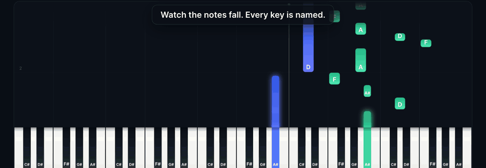
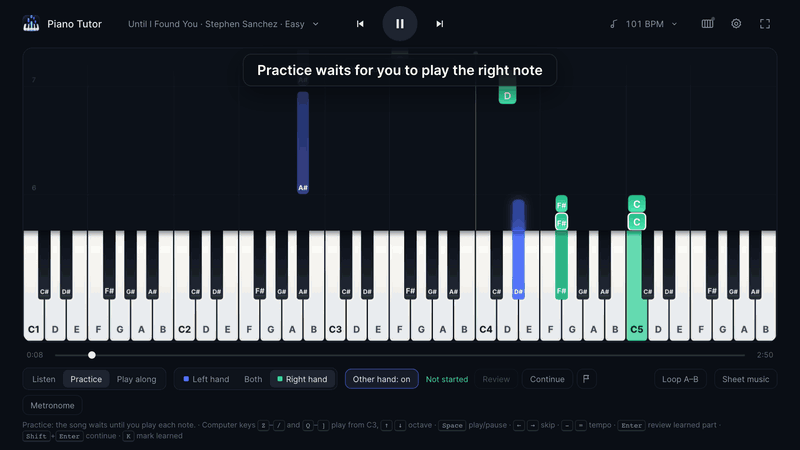
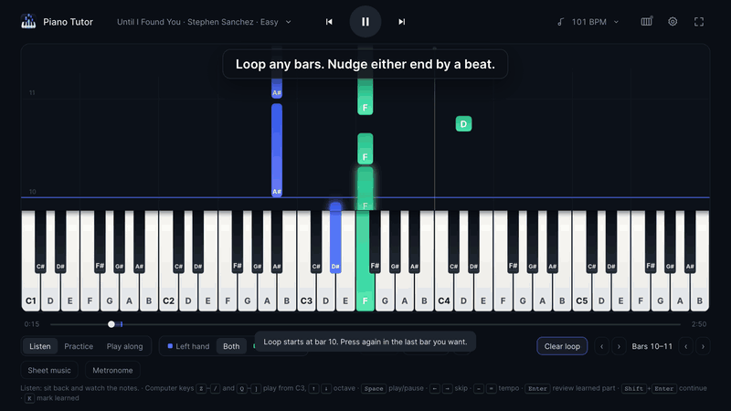
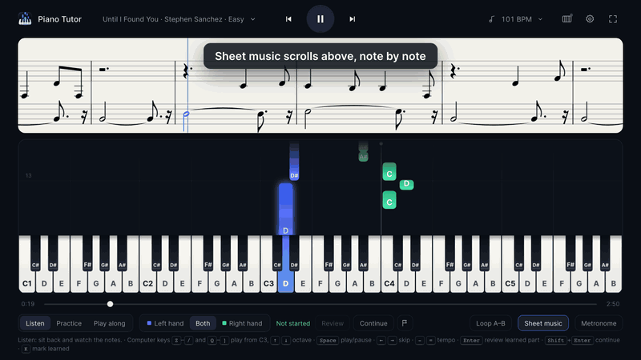
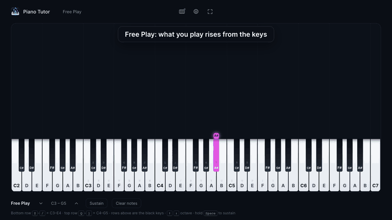
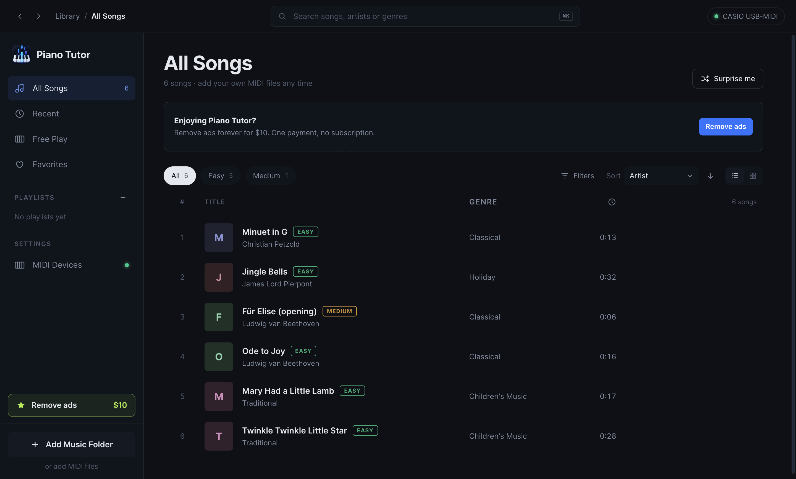
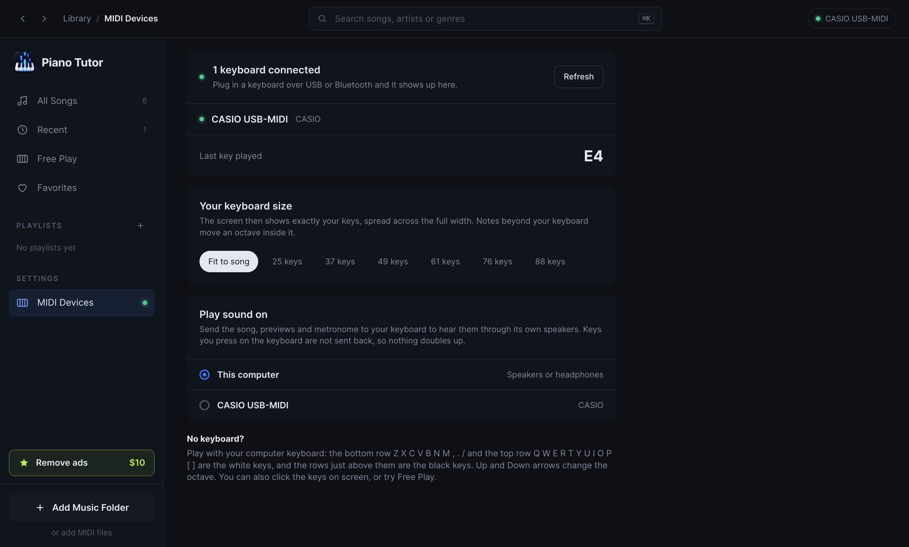
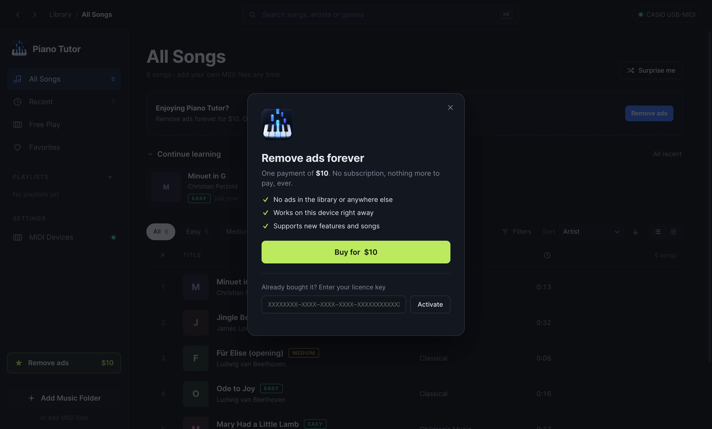

<p align="center"></p>

<p align="center">
  <a href="https://ghanshyampaunikar.com/pianotutor"></a>
  <a href="https://github.com/GhanshyamPaunikar/piano-tutor/releases/latest"></a>
  <a href="https://github.com/GhanshyamPaunikar/piano-tutor/releases/latest"></a>
  <a href="https://ghanshyampaunikar.com/"></a>
  <a href="https://www.linkedin.com/in/ghanshyampaunikar/"></a>
  <a href="https://www.instagram.com/ghanshyampaunikar/"></a>
  <a href="https://github.com/GhanshyamPaunikar"></a>
</p>

<h1 align="center">Piano Tutor</h1>

<p align="center"><b>Learn piano with falling notes. Every key named.</b></p>

<p align="center">Watch the notes fall, press the keys that light up, and play real songs from day one.<br>Practice waits for you, one hand at a time. Works with any MIDI keyboard, or your computer keys.</p>

<p align="center"><b><a href="https://ghanshyampaunikar.com/pianotutor">Try it in your browser</a></b> · <a href="https://github.com/GhanshyamPaunikar/piano-tutor/releases/latest">Download for Mac or Windows</a> · <a href="#for-developers">How it is built</a></p>

<br>

## It waits for you.

<p align="center"></p>

In **Practice** the song stops at every note until you play the key that lights up. No pressure, no falling behind. Learn the **right hand**, then the **left**, then **both**, while the app plays the other hand for you. When you are ready, **Play along** keeps the song moving in real time.

Piano Tutor remembers how far you have learned each song. Press **Enter** to replay everything you know from the start, or **Shift Enter** to pick up a bar before where you stopped. That is how piano teachers build a song: review what you know, then add a little more.

<br>

## Loop the hard part.

<p align="center"></p>

Press **Loop A–B** in the first bar you want and again in the last. The loop snaps to whole bars, and the arrows either side of the **Bars 10–11** label move its start or end by a single beat. Slow it down to 50% and speed it back up as it sticks.

<br>

## Read music as you play.

<p align="center"></p>

Turn on **Sheet music** and a grand staff, generated from the song, scrolls above the keyboard and highlights each note as it plays. The falling notes teach your hands; the score teaches your eyes.

<br>

## Or just play.

<p align="center"></p>

**Free Play** is a piano with nothing to follow. Every note you press rises from the keys in colour, which is perfect for warming up or working out a melody by ear.

<br>

## Compared with a typical piano app.

| | Piano Tutor | Typical subscription piano app |
|---|:---:|:---:|
| Free, with every feature included | ✅ Yes | ❌ No |
| No account to create | ✅ Yes | ❌ No |
| Works with no internet connection (desktop app) | ✅ Yes | ❌ Rarely |
| Load any MIDI file or folder of songs | ✅ Yes | ❌ Rarely |
| Every falling note and key shows its name | ✅ Yes | ❌ Rarely |
| Practice waits for each note, one hand at a time | ✅ Yes | ✅ Yes |
| Loops that snap to bars, adjustable by the beat | ✅ Yes | ❌ Rarely |
| Sound through your keyboard's own speakers | ✅ Yes | ❌ Rarely |

<br>

## Features

| | |
|---|---|
| **Three ways to learn** | **Listen** to a song first, **Practice** with the song waiting for you, then **Play along** in real time. |
| **Hands separately** | Left hand, right hand or both. Choose whether you hear the other hand or play in silence. |
| **Tempo control** | Slow a song down to 50% and speed it back up as you improve. |
| **Review what you know** | Piano Tutor tracks how far you have learned each song, for each hand. One key replays the song from the start up to that point, on repeat. Another starts a bar before where you stopped. |
| **Loop any bars** | Loops snap to whole bars, and either end moves by a beat for precision. |
| **Sheet music** | A scrolling grand staff generated from the song, highlighting each note as it plays. |
| **Metronome** | A gentle click on every beat, with an accent on the first. |
| **Keyboard sizes** | 25, 37, 49, 61, 76 or 88 keys. Notes beyond your keyboard move an octave inside it, so every song fits. |
| **Sound on your keyboard** | Send the song to your digital piano's speakers instead of the computer, in your keyboard's own tone or one you choose. |
| **Tones** | Grand piano, electric piano, organ, strings, synth or music box. |
| **Sustain pedal** | Your keyboard's sustain pedal just works. |
| **Previews** | Click any song to hear 30 seconds before you start. |
| **Your music folder** | Point Piano Tutor at a folder of MIDI files once. It remembers it and reads every subfolder. |
| **Works offline** | The desktop app and its piano sound need no internet connection. |

<table>
<tr>
<td width="50%"><br><b>Your song library</b><br>Search by title, artist or genre. Filter by difficulty, sort by artist, jump A to Z, and keep favourites and playlists.</td>
<td width="50%"><br><b>Made for your keyboard</b><br>Pick your keyboard size (25 to 88 keys) and the screen shows exactly your keys. Play the song through your keyboard's own speakers.</td>
</tr>
</table>

## Get Piano Tutor

### Mac and Windows

Download the latest version from the **[Releases page](https://github.com/GhanshyamPaunikar/piano-tutor/releases/latest)**:

| Your computer | Download |
|---|---|
| Mac with Apple silicon (M1, M2, M3, M4) | `Piano-Tutor-1.0.0-arm64.dmg` |
| Mac with Intel processor | `Piano-Tutor-1.0.0-x64.dmg` |
| Windows 10 or 11 | `Piano-Tutor-Setup-1.0.0.exe` |

> **First launch.** Piano Tutor is not yet signed with an Apple or Microsoft certificate, so your computer asks before opening it the first time.
> **Mac:** right-click the app and choose **Open**, or go to System Settings, Privacy & Security, and click **Open Anyway**.
> **Windows:** if SmartScreen appears, click **More info**, then **Run anyway**.

### In your browser

Open **[ghanshyampaunikar.com/pianotutor](https://ghanshyampaunikar.com/pianotutor)**: no install, with more than 2,000 songs to learn. Use Chrome or Edge to connect a MIDI keyboard. iPhone and iPad browsers can't use MIDI keyboards, so open the page in the free [Web MIDI Browser](https://apps.apple.com/app/id953846217) app there, or play on screen.

To run the web version from this repository:

```bash
git clone https://github.com/GhanshyamPaunikar/piano-tutor.git
cd piano-tutor
python3 serve.py
```

Then open **http://localhost:5173**.

## Connect your keyboard

1. Plug your keyboard into your computer with a USB cable (or pair it over Bluetooth MIDI).
2. Open **MIDI Devices** in the sidebar and click **Connect keyboard**.
3. Choose your **keyboard size** so the screen matches the keys in front of you.
4. Optional: under **Play sound on**, choose your keyboard to hear everything through its speakers.

### No keyboard? Use your computer

Your computer keyboard becomes a two-octave piano:

```
 Black keys:   2  3     5  6  7     9  0
 White keys:  Q  W  E  R  T  Y  U  I  O  P  [  ]      (starts at C4)

 Black keys:   S  D     G  H  J     L  ;
 White keys:  Z  X  C  V  B  N  M  ,  .  /            (starts at C3)
```

Press **Up** and **Down** to change octave. In Free Play, hold **Space** to sustain.

## Keyboard shortcuts

| Where | Key | Action |
|---|---|---|
| Library | `Cmd K` or `/` | Search |
| Library | `Up` `Down` | Move through songs |
| Library | `Enter` | Learn the song |
| Library | `Space` | Play or stop a preview |
| Library | `L` `R` | Learn the left or right hand only |
| Library | `F` | Add to favourites |
| Library | `X` | Select (Shift for a range) |
| Player | `Space` | Play or pause |
| Player | `Left` `Right` | Skip 5 seconds |
| Player | `-` `=` | Slower or faster |
| Player | `Enter` | Review: replay from the start to where you have learned |
| Player | `Shift Enter` | Continue learning from where you stopped |
| Player | `K` | Mark everything up to here as learned |
| Anywhere | `Esc` | Back, close or clear |

## Free, with an option to remove ads

Piano Tutor is free with every feature included. The free version shows a small ad. If you enjoy it, a **one-time payment of $10 removes the ads forever**: no subscription, no account, nothing more to pay. You receive a licence key by email; paste it under **Remove ads** and the ads disappear.



---

## For developers

Piano Tutor is a plain web app (HTML, CSS and JavaScript modules, no build step) with an [Electron](https://www.electronjs.org/) shell for the desktop apps.

```
index.html          the whole interface
style.css           styles
js/app.js           player: falling notes, input, practice modes, Free Play
js/library.js       library: songs, search, filters, playlists, favourites
js/song.js          MIDI file to song, hand detection
js/sheet.js         sheet music
js/audio.js         piano sound, metronome, sound on a MIDI keyboard
js/monetize.js      ads and the Remove ads licence
js/config.js        your AdSense and Lemon Squeezy settings
starter/            songs that ship with the app (public domain, arranged for Piano Tutor)
desktop/            Electron main process, icon and build settings
tools/              song collection, web build and the README animations
docs/media/         README animations, recorded from the real app
```

### Run and build

```bash
npm install            # once
npm start              # run the desktop app
npm run dist           # build the Mac (.dmg) and Windows (.exe) installers into dist/
npm run screenshots    # retake the screenshots in docs/screenshots
PIANO_TUTOR_EVAL=test.js npx electron .   # run a test script inside the hidden app and print its result
python3 serve.py       # run the web version at http://localhost:5173
```

### The README animations

The animations in `docs/media` are recorded from the real app, frame by frame on a virtual clock, so every frame is exact rather than a screen recording.

```bash
python3 tools/tour/record.py tour                   # frames of each scene (with python3 serve.py running)
python3 tools/tour/build_media.py tour docs/media   # the GIFs here
```

### Set up ads and the Remove ads purchase

Everything lives in [`js/config.js`](js/config.js):

1. **Ads on the website.** Create a [Google AdSense](https://adsense.google.com) account for your domain, create two ad units, then fill in `adsenseClient` and the two `slots`. Until then, and always in the desktop app, the ad spot shows a "Remove ads" banner instead.
2. **The $10 purchase.** Create a [Lemon Squeezy](https://www.lemonsqueezy.com) store and a product priced at $10 with **licence keys enabled**. Put the product's checkout link in `checkoutUrl`, and its `storeId` and `productId` so only your keys unlock the app. Lemon Squeezy handles payment, tax and the receipt email with the key.

### Bundling songs

Use **Add Music Folder** in the app, or bundle a collection: put MIDI files in a folder and run

```bash
python3 tools/build_collection.py path/to/your/midi/folder
```

This copies them into `songs/` and writes `songs/index.json` with title, artist, level and length for each song (file names like `Artist - Title (Easy).mid` are understood). Only bundle songs you have the right to distribute.

## Licence

Copyright Ghanshyam Paunikar. All rights reserved.
